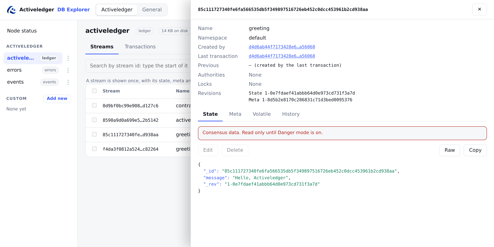
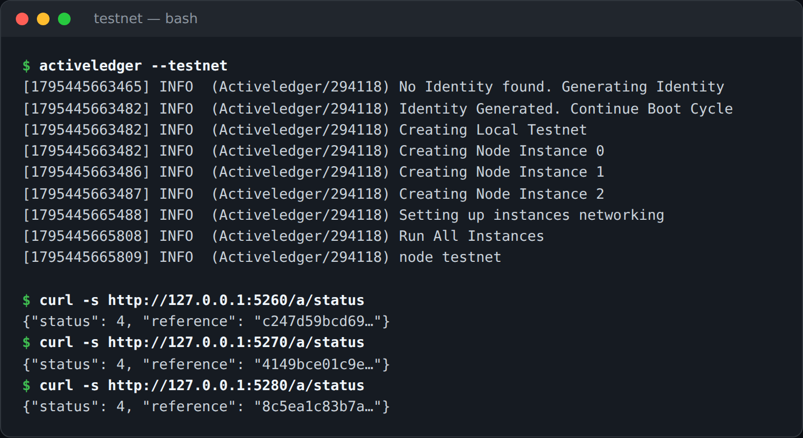
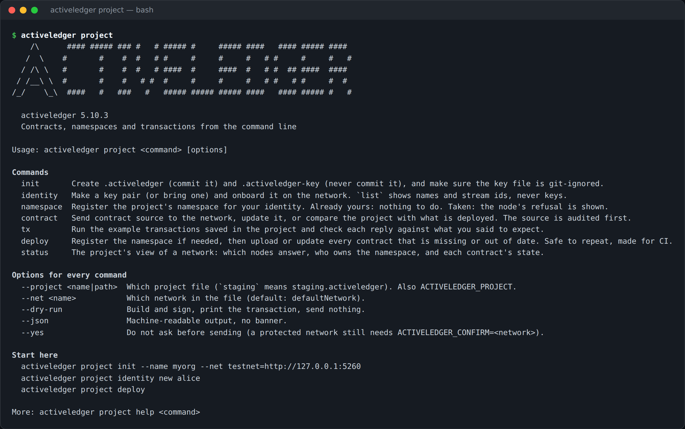
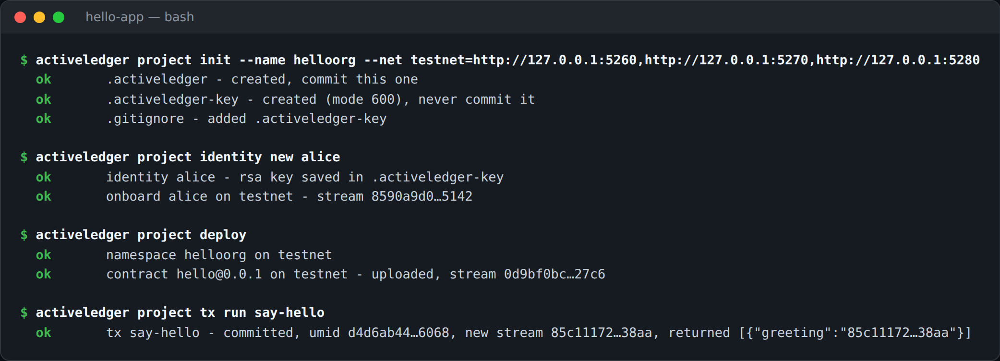
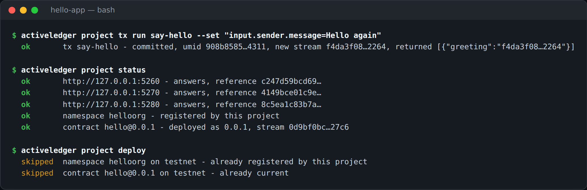
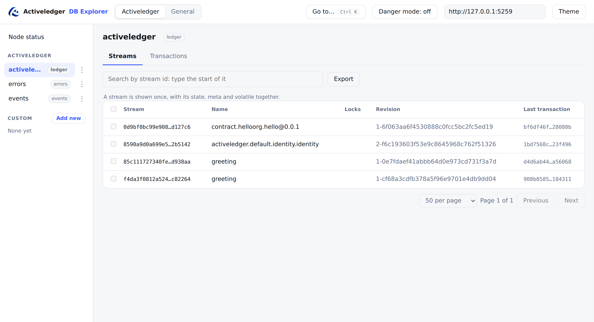
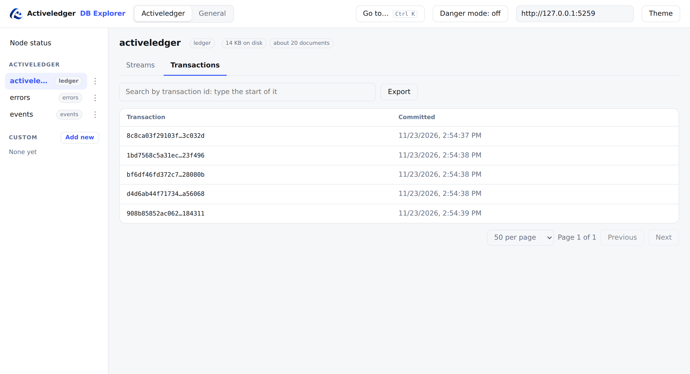
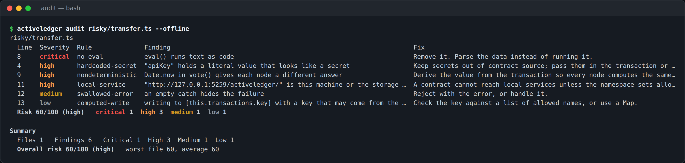

[](https://badge.fury.io/js/%40activeledger%2Factiveledger) 
[](https://www.npmjs.com/package/@activeledger/activeledger) 
[](https://lbesson.mit-license.org/)

<picture>
  <source media="(prefers-color-scheme: dark)" srcset="docs/assets/Asset-23-dark.png">
  
</picture>

Activeledger is a distributed ledger technology. A network of permissioned nodes gossips transactions to each other, votes on them, and commits the ones that reach consensus, each node reaching its own conclusion by watching the same traffic rather than waiting on a single leader. Application logic lives in smart contracts written in TypeScript, executed in a per-transaction worker process and checked by a security scan at deploy time. Consensus is tracked per stream rather than globally, so unrelated transactions are voted on and committed at the same time.



*A contract's output, read back from a node's own database in the built-in explorer. It is the "hello" contract below, run on a local three-node network.*

## Try it in five minutes

You need **Node.js 24**, the version Activeledger is built and tested on. Everything below was run exactly as written on a clean local network.

### 1. Install

```bash
npm i -g --allow-scripts=classic-level,msgpackr-extract @activeledger/activeledger @activeledger/activerestore
```

> **The `--allow-scripts` flag matters on npm 11.19 and later**, which no longer runs install scripts by default. Activeledger's datastore builds a native LevelDB binding during install; without the flag the install succeeds and the failure only shows later, at runtime. On an older npm the flag is harmless.

### 2. Start a three-node network on your machine

```bash
mkdir testnet && cd testnet
activeledger --testnet      # creates instance-0, instance-1 and instance-2
node testnet                # starts all three; leave this running
```



The nodes answer on ports 5260, 5270 and 5280. Open a second terminal for the rest.

### 3. Write a contract

A contract is one TypeScript file: a class that extends `Standard`. Save this as `src/hello.ts` in a new folder:

```ts
import { Standard, Activity } from "@activeledger/activecontracts";

export default class Hello extends Standard {
  private message: string;
  private greeting: Activity;

  public verify(selfsigned: boolean): Promise<boolean> {
    return selfsigned ? Promise.reject("No self sign") : Promise.resolve(true);
  }

  public vote(): Promise<boolean> {
    // "sender" is the label the transaction gives the signing stream
    this.message = this.transactions.$i.sender.message as string;
    return this.message ? Promise.resolve(true) : Promise.reject("A message is needed");
  }

  public commit(): Promise<any> {
    this.greeting = this.newActivityStream("greeting");
    this.greeting.setState({ message: this.message });
    this.returnToRemote({ greeting: this.greeting.getId() });
    return Promise.resolve(true);
  }
}
```

The transaction gives the signing stream the label `sender`, and the contract reads it by that label (`this.transactions.$i.sender`) rather than by its position in the list of inputs. It checks that a message was sent, then writes it to a new stream and hands the stream's id back. [Writing a contract](docs/guide/contracts/write.md) explains each part, and builds a bigger one.

### 4. Deploy it and run it

`activeledger project` does the setup for you. Run it on its own to see every command:



In your folder (a git repository is best, so the key file can be kept out of it):

```bash
git init
activeledger project init --name helloorg --net testnet=http://127.0.0.1:5260,http://127.0.0.1:5270,http://127.0.0.1:5280
activeledger project identity new alice
```

Pick a namespace of your own in place of `helloorg`: names are unique on a network. This made `.activeledger` (the project, which you commit) and `.activeledger-key` (your keys, which the command makes sure git ignores). Now tell the project about the contract and an example transaction, by adding these to `.activeledger`:

```json
"contracts": {
  "hello": { "source": "src/hello.ts", "version": "0.0.1" }
},
"transactions": {
  "say-hello": {
    "contract": "hello",
    "entry": "create",
    "input": { "sender": { "$stream": "@alice", "message": "Hello, Activeledger" } }
  }
}
```

```bash
activeledger project deploy            # registers the namespace, audits and uploads the contract
activeledger project tx run say-hello  # signs and sends the example, and checks the reply
```



Change a value for one run with `--set`, ask the network what it holds, or deploy again (it sees nothing changed and sends nothing):

```bash
activeledger project tx run say-hello --set "input.sender.message=Hello again"
activeledger project status
activeledger project deploy
```



Everything `project` sends is an ordinary signed transaction. [Project commands](docs/guide/cli/project.md) has the file formats, how keys are kept safe, protected networks, CI use and a troubleshooting table.

### 5. Look at what you made

Every node serves a browser view of its own database, the explorer. Open the first node's:

```
http://127.0.0.1:5259/_explorer
```



Each stream is shown with its state, meta, volatile data and history. Click the `greeting` stream your transaction made to see the message (the picture at the top). Every transaction the node has committed is listed too, and the page can export, compact and back up the database:



The explorer has no login, so keep the store on loopback. Ledger data is read only unless you turn on Danger mode. How it works, and everything it can do: [The database explorer](docs/guide/operate/explorer.md).

### 6. Check a contract before you deploy it

```bash
activeledger audit src/                      # a table per file, then a 0-100 risk score
activeledger audit src/ --fail-on high       # exit 1 on a high or critical finding, for CI
```



*A contract written to be wrong: it runs `eval`, holds a key, reads the clock in `vote`, reaches for the storage port and hides an error.*

The audit finds `eval`, hard-coded secrets, time and randomness inside a vote (where each node would disagree), reaches for the storage port and local services, empty `catch` blocks, duplicate code and known advisories in the packages a contract imports. `deploy` runs it for you. See [Auditing a contract](docs/guide/contracts/audit.md).

## What is in the box

| | |
|---|---|
| `activeledger` | The node. Consensus per stream, TypeScript contracts with a deploy-time security scan, and contract events. |
| `activeledger project` | Namespaces, contracts and example transactions from a committed `.activeledger` file, with keys kept out of git. [Guide](docs/guide/cli/project.md) |
| `activeledger audit` | Contract security, best practice, duplicate code and dependency advisories, with a risk score. [Guide](docs/guide/contracts/audit.md) |
| The explorer | A browser view of a node's own database (ledger data read only by default), at `/_explorer` on its storage port. [Guide](docs/guide/operate/explorer.md) |
| Leader mode | A stream written by one client at a time can commit as soon as the node that owns it votes yes. [Guide](docs/guide/operate/nodes.md#leader-mode) |
| `activehybrid` | Light followers of the ledger that do not vote. [Guide](docs/guide/hybrid/index.md) |
| `activerestore` | Heals a node that fell behind or came up empty. |
| SDKs | [JavaScript](https://activeledger.github.io/activeledger/sdks/js/), [Python](https://activeledger.github.io/activeledger/sdks/python/), [Go](https://activeledger.github.io/activeledger/sdks/go/), [JVM](https://activeledger.github.io/activeledger/sdks/jvm/), [C#](https://activeledger.github.io/activeledger/sdks/csharp/), [Rust](https://activeledger.github.io/activeledger/sdks/rust/), [PHP](https://activeledger.github.io/activeledger/sdks/php/), [Dart](https://activeledger.github.io/activeledger/sdks/dart/), [Swift](https://activeledger.github.io/activeledger/sdks/swift/) |

## Documentation

- [The Activeledger guide](https://activeledger.github.io/activeledger/) for running, operating and using Activeledger. The same pages are in [`docs/guide`](docs/guide/index.md).
- [Your first network](docs/guide/first-network.md), [Keys, identities and namespaces](docs/guide/identities.md), [Writing a contract](docs/guide/contracts/write.md), [Deploy, update, lock and unlock](docs/guide/contracts/deploy.md), [Sending a transaction](docs/guide/transactions.md).
- [Developing Activeledger](DEVELOPING.md): building from source, the tests, the stress tests, profiling and releases.

<details>
<summary>Node.js versions</summary>

**Node.js 24.x** (the current LTS line) is the version Activeledger is built and tested on: every workflow in `.github/workflows/` builds, tests and publishes on 24, and the packages declare `"node": ">=24.0.0"`. Other versions are not tested. You can try one, but the native HTTP and consensus transport ([uWebSockets.js](https://github.com/uNetworking/uWebSockets.js)) ships prebuilt bindings for a specific set of Node majors, and an unsupported version fails with an error like `This version of uWS.js (...) supports only Node.js versions ...`. Check that `node_modules/uWebSockets.js` itself is up to date (`npm i` again) before assuming a version genuinely is not supported.

</details>

## Operating a network

### Protocol level (`build`)

`build` in a node's `config.json` switches on protocol features that change
what nodes write to the ledger. Every node on a network must run at the same
level: a node above its peers writes state they do not, and the streams it
touches diverge.

| `build` | Enables | Since |
|---|---|---|
| 40100 | Contract streams store a `{umid, hash}` reference instead of the source; authority keys can carry an `expire` date | 4.8.0 |
| 40200 | New contract versions compile to ES2025 (see the 4.10.0 changelog for the one breaking case) | 4.10.0 |
| 40250 | Two fixes to the stream permission check (a contract `:data` stream with an ordinary stream, and `$sigOnly` inputs) | 5.2.0 |
| 40300 | Hybrid nodes: signed votes and commit attestations, the `hybrid` section on the ledger, the `/h/*` API, contract update locks. Votes and attestations are only signed once the network turns hybrids on (below) | 5.3.0 |
| 50300 | Nothing new: new installs started here from 5.3.0 to 5.5.0 so the number matched the release. Everything up to 40300 is on | 5.3.0 |
| 50600 | A contract runs only for the namespace it lives in: the loaded-contract cache is keyed by namespace and contract | 5.6.0 |

A new node gets **50600**: its `config.json` is generated from the default the
first time it starts. An existing `config.json` is never changed by an upgrade.

**Upgrading an existing network.** Upgrade every node first, leaving `build`
alone. Once all of them run the new release, set `"build": 50600` in each
node's `config.json` and restart it, or call `/a/admin-reload` on nodes with
`remote` enabled. Raising it before every node is upgraded splits the network.

**Adding a node to an existing network.** Its generated config says 50600. Set
`build` to whatever the rest of the network runs before it joins.

#### Hybrid nodes

Build 40300 adds [hybrid nodes](docs/guide/hybrid/index.md), light followers of the ledger. It costs a
network nothing until hybrids are turned on: until then the supernodes sign no votes and keep no
attestations. Turning them on is one command, run on a node of a network that is already on 40300:

```bash
activeledger hybrid status          # is it on, what admission, how many registered, what this node signs with
activeledger hybrid enable          # turn it on; no hybrid can register until you allow its key
activeledger hybrid allow <key>     # let a hybrid register (or: hybrid enable open)
```

On a network of more than one node the change needs more than half of the nodes to sign it
(`--out <file>`, then `hybrid sign <file>` on the others and `hybrid submit <file>`). See
[Set up and run a hybrid](docs/guide/hybrid/run.md).

### Pruning old data

A node's error records and events only grow. `activeledger prune` removes what is older than a number of
days (it keeps the last 30 unless you say), from the node's own working stores and never from the ledger:

```bash
activeledger prune --dry-run         # say what would be removed, remove nothing
activeledger prune 30                # keep 30 days of errors, remove the rest (handled errors and the archive)
activeledger prune 30 --include-umids --include-events   # also the umid index and contract events
```

Each choice has a cost, written up in [Pruning old data](docs/guide/operate/prune.md).

### Installing from GitHub Packages

Releases go to npmjs.com and are mirrored to the [GitHub Packages npm registry](https://github.com/orgs/activeledger/packages), so the quickstart above installs without any authentication. The one gap is the start of the 4.x line: v4.0.0 through v4.3.2 were published to GitHub Packages only, and every release from v4.3.3 onward is on both.

To install from GitHub Packages instead, note that it requires authentication even on public repositories, so add an `.npmrc` alongside your `package.json` (do not commit a real token):

```
@activeledger:registry=https://npm.pkg.github.com
//npm.pkg.github.com/:_authToken=${NODE_AUTH_TOKEN}
```

Then set `NODE_AUTH_TOKEN` to a GitHub personal access token with `read:packages` scope (a fine-grained token scoped to this org is fine) and install as normal:

```bash
export NODE_AUTH_TOKEN=<your github token>
npm i -g --allow-scripts=classic-level,msgpackr-extract @activeledger/activeledger @activeledger/activerestore
```

For a Docker build, pass the token in as a build secret (e.g. `--secret id=npmrc,src=.npmrc` with a `RUN --mount=type=secret,id=npmrc,target=/root/.npmrc npm i -g ...` step) rather than baking it into an image layer.

## License

[MIT](https://github.com/activeledger/activeledger/blob/master/LICENSE)
