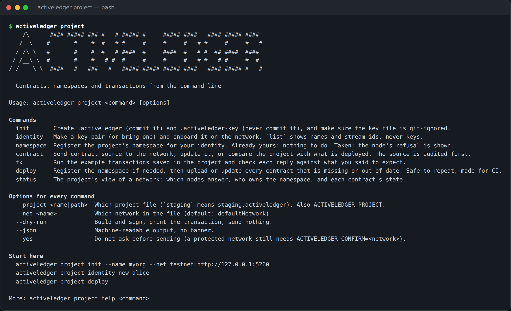
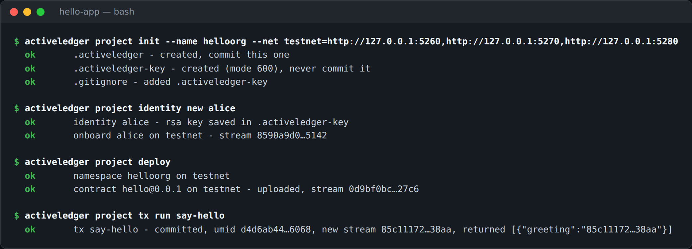

# Project commands: set up and deploy from the terminal

`activeledger project` does the setup work for you: it makes an identity, registers a namespace, uploads and updates contracts, and runs example transactions, all from files you can commit. Everything it sends is an ordinary signed transaction, the same ones described in [Keys, identities and namespaces](../identities.md) and [Deploy, update, lock and unlock](../contracts/deploy.md).

Run it on its own to see every command and how to use it:

```
activeledger project
```

```
        /\
       /  \
      / /\ \
     / /  \ \
    / /____\ \
   /_/      \_\

 ###   #### ##### ### #   # ##### #     ##### ####   #### ##### #### 
 ...

Usage: activeledger project <command> [options]

Commands
  init       Create .activeledger (commit it) and .activeledger-key (never commit it), ...
  identity   Make a key pair (or bring one) and onboard it on the network. ...
  namespace  Register the project's namespace for your identity. ...
  contract   Send contract source to the network, update it, or compare ...
  tx         Run the example transactions saved in the project ...
  deploy     Register the namespace if needed, then upload or update every contract ...
  status     The project's view of a network ...
```



The banner is drawn only for a person at a terminal. It is left out with `--json`, `--quiet`, in CI (`CI` is set) and with `NO_BANNER`. `activeledger project help <command>` shows one command with an example.

## Your contract is TypeScript

A contract is one TypeScript file (`.ts`): a class that extends `Standard` from `@activeledger/activecontracts`, with `verify`, `vote` and `commit` methods. [Writing a contract](../contracts/write.md) builds one from an empty file.

You send the TypeScript source, not compiled JavaScript. Every node transpiles the source it is sent, once, when the contract is deployed, checks it against its security rules and then runs the compiled result. That is why the project commands only accept `.ts` files: `project` sends your source as it is, and a `.js` file is refused (and skipped by `audit`). Declaration files (`.d.ts`) are not contracts either.

Before you deploy you can check three things, all from the project folder:

```
npx tsc --noEmit --skipLibCheck --alwaysStrict --noImplicitAny --strictNullChecks --strictPropertyInitialization false --target es2017 --module commonjs src/notebook.ts
activeledger audit src/notebook.ts
activeledger project contract status
```

The first is the type check a node's compiler would make ([Writing a contract](../contracts/write.md#4-check-that-it-compiles)), the second the [audit](../contracts/audit.md), the third whether the network already has this version of the file. `contract upload`, `contract update` and `deploy` run the audit for you.

## From nothing to a running contract

This uses the notebook contract from [Writing a contract](../contracts/write.md), saved as `src/notebook.ts`, and a local testnet (`activeledger --testnet` builds a three-node one; see [Your first network](../first-network.md#a-local-test-network-in-one-command); its nodes answer on ports 5260, 5270 and 5280).

**1. Start the project.** In your project's folder, ideally already a git repository:

```
activeledger project init --name myorg --net testnet=http://127.0.0.1:5260,http://127.0.0.1:5270,http://127.0.0.1:5280
```

This creates `.activeledger` and `.activeledger-key` and adds the key file to `.gitignore`. `myorg` is the namespace your contracts will live in.

**2. Make yourself an identity.**

```
activeledger project identity new alice
```

This makes an `rsa` key pair (`--type secp256k1`, `ed25519` and the other types in [Keys, identities and namespaces](../identities.md) work too), saves it in `.activeledger-key`, and sends the self-signed `onboard` transaction. The identity's stream id on that network is recorded beside the key. Run `identity list` to see it.

**3. Tell the project about the contract and an example.** Open `.activeledger` and add:

```json
"contracts": {
  "notebook": { "source": "src/notebook.ts", "version": "0.0.1" }
},
"transactions": {
  "create-notebook": {
    "contract": "notebook",
    "entry": "create",
    "input": { "@alice": { "note": "my first note" } }
  }
}
```

**4. Deploy.**

```
activeledger project deploy
```

```
  ok       namespace myorg on testnet
  ok       contract notebook@0.0.1 on testnet - uploaded, stream 579023d4...
```

`deploy` registered the namespace (the `namespace` contract transaction), audited `src/notebook.ts`, and uploaded it (the `contract` contract's deploy transaction, with your source as base64 in `contract`). The contract's stream id, the version and a hash of the source are saved in `.activeledger` under `networks.testnet.contracts`. Run it again and it says `already current` and sends nothing.

**5. Run the example.**

```
activeledger project tx run create-notebook
```

```
  ok       tx create-notebook - committed, umid 8f29f4fb..., new stream 3b1c0d2e..., returned [{"notebook":"3b1c0d2e...","count":1}]
```

The example was built from your project (`@alice` became your stream id, the contract name became its stream id), signed with your key and sent. `expect` was left out, so it passed because at least one node committed it and nothing errored.



**6. Use what it made.** Adding a note needs the notebook's stream id, which you now have. Add a second example, and give the id when you run it with `--set` (a path of keys, then `=` and a JSON value):

```json
"add-note": {
  "contract": "notebook",
  "entry": "add",
  "input": { "@alice": { "note": "another one" } },
  "output": {}
}
```

```
activeledger project tx run add-note --set "output.3b1c0d2e...={}"
```

**7. Change the contract.** Edit `src/notebook.ts`, change `"version"` to `"0.0.2"` in `.activeledger`, and run `activeledger project deploy` again: it sees the source changed and sends an update. Change the source without changing the version and it stops and asks you to bump it, because the network keeps every version and a version's source must not change.

**8. Commit.** `git add -A` adds `.activeledger`, the contract and `.gitignore`, and leaves the key file out. Someone else who clones the repository runs `identity new` for their own identity (or you share a key by other means) and `deploy` for their own network.

## The two files

**`.activeledger`** is the project. It holds no secrets, and you commit it.

```json
{
  "version": 1,
  "namespace": "myorg",
  "defaultNetwork": "testnet",
  "networks": {
    "testnet": { "nodes": ["http://127.0.0.1:5260", "http://127.0.0.1:5261"] },
    "production": { "nodes": ["https://node1.example.com:5260"], "protected": true }
  },
  "contracts": {
    "notebook": { "source": "src/notebook.ts", "version": "0.0.1" }
  },
  "transactions": {
    "add-note": {
      "contract": "notebook",
      "entry": "create",
      "input": { "@alice": { "note": "hello" } },
      "output": {},
      "expect": { "commit": 1 }
    }
  }
}
```

- `contracts` is what the project has: the source file and the version you are working on. The CLI also writes what each network has (the contract's stream id, the version and a hash of the source last sent) under `networks.<name>.contracts`, so a second `deploy` knows there is nothing to do.
- Nodes must be `https`, except `http` to this machine. Set `"insecure": true` on a network to allow plain `http` elsewhere.
- `"protected": true` asks for a typed confirmation before anything is sent to that network. `--yes` does not skip it; in CI set `ACTIVELEDGER_CONFIRM=<network name>`.
- In an example transaction, `@alice` means that identity's stream id on the chosen network, `@namespace` the project's namespace and `@contract:notebook` a deployed contract's stream id. `@alice` works as a key too, and as the `$stream` of a labelled input (see below). Nothing else is substituted.
- An input may be a label instead of a stream id, as long as it carries `$stream`: `"input": { "sender": { "$stream": "@alice", "message": "hi" } }`. The contract then reads it by the label (`this.transactions.$i.sender`) instead of by its position in the list of inputs, which is steadier and easier to read. The example is still signed by the stream in `$stream`. See [Sending a transaction](../transactions.md).
- `expect`: `{ "commit": 1 }` (the default) means at least one node committed and nothing errored. `{ "commit": 3 }` wants three, `{ "commit": "all" }` every node. `{ "error": "Namespace Reserved" }` means the run must fail with an error containing that text, so a refusal can be an example.

Treat `.activeledger` like a script: it chooses which nodes your signed transactions go to and which files are uploaded. Read one you did not write before you run it. A contract source must be a TypeScript (`.ts`) file inside the project's folder, and never the key file.

**`.activeledger-key`** holds the identities: the type, the private and public key, and the identity's stream id on each network. It is created with mode 600 and never printed.

**Never commit it.** The CLI makes sure it does not get committed:

- `init` adds it to `.gitignore`.
- Before any command reads it, the CLI checks that git ignores it and has not tracked it. If it is not ignored you are told to run `activeledger project init --fix-ignore`. If it is already tracked it is refused, with the `git rm --cached` command to run (and a reminder that the keys in it are exposed and should be rotated).
- A key file that other users can read, or that is a symbolic link, or is owned by someone else, is refused.
- Outside a git repository the CLI warns once and carries on. `--allow-unignored-key` skips the check for CI containers and warns every time.

### More than one project

A folder can hold several project files, for example one per environment:

```
.activeledger            .activeledger-key
staging.activeledger     staging.activeledger-key
```

Each has its own key file, named after it with `-key` on the end. Choose with `--project staging` (or `ACTIVELEDGER_PROJECT=staging`). With more than one in a folder and none chosen, the command stops and lists them. Looking upward from a folder stops at the git repository's root, and a file found that way must be a real file you own.

## Commands

| Command | What it does |
|---|---|
| `init [--name <ns>] [--net <name>=<url>[,<url>...]] [--fix-ignore]` | Creates both files and the `.gitignore` line. Never overwrites an existing project file. |
| `identity new <name> [--type rsa]` | Makes a key pair, saves it, and onboards it on the network. If onboarding fails the key is kept; `identity onboard <name>` retries it. |
| `identity import <name> <private file> <public file> [--type <t>]` | Brings an existing key pair and onboards it. |
| `identity onboard <name>` | Onboards a saved identity on the chosen network (for a second network, or a retry). |
| `identity list` | Names, key types and stream ids. Never keys. |
| `namespace register [<ns>]` | Registers the namespace. A second call for the same project does nothing. A name that is taken is refused (`Namespace Reserved`). |
| `contract upload <name>\\|--all` | Audits the source, sends it, and records the stream id, version and hash. |
| `contract update <name>\\|--all` | Sends a new version. Does nothing if the source has not changed. If the source changed but `version` did not, it asks you to bump `version`. |
| `contract status [<name>]` | Not deployed, current, or out of date. Reads files only; sends nothing and needs no key. |
| `tx run <name>\\|--all [--set key=value]...` | Signs and sends an example and checks the reply against `expect`. `--set input.@alice.note=hi` changes a value for one run. `--all` stops at the first failure. |
| `tx list` | The saved examples. |
| `deploy [--all\\|<name>...]` | Registers the namespace if needed, then uploads or updates what is missing or out of date. Safe to run again, so it suits CI. |
| `status` | Which nodes answer, whether the project registered its namespace, and each contract's state. |

Options for every command: `--project`, `--net <name>` (default `defaultNetwork`), `--dry-run` (build and sign, print the transaction, send and write nothing), `--json`, `--yes`.

A send goes to the first node that answers. It moves on to the next node only when a node cannot be reached; a refusal is an answer and is shown as one.

## The audit before an upload

`contract upload`, `contract update` and `deploy` run [`activeledger audit`](../contracts/audit.md) on the source first and stop on a high or critical finding. `--no-audit` skips it, `--audit-fail-on <severity>` changes the bar (`critical`, `high`, `medium` or `low`) and `--offline` skips the dependency lookup. The node's own deploy scan still decides whether the contract is accepted.

## When something goes wrong

| You see | What it means | What to do |
|---|---|---|
| `no project file found. Run activeledger project init first.` | No `.activeledger` in this folder, or in the folders above it up to the git repository's root. | Run `init`, or name the file with `--project`. |
| `more than one project file in ...` | Several `*.activeledger` files and none chosen. | `--project <name>` or `ACTIVELEDGER_PROJECT`. |
| `.activeledger-key is not ignored by git` | The key file could be committed. | `activeledger project init --fix-ignore`. |
| `.activeledger-key is tracked by git` | Its keys are already in the repository. | `git rm --cached .activeledger-key`, then make new keys: the old ones are exposed. |
| `identity "alice" is not onboarded on testnet` | The key exists but the network has not seen it. | `activeledger project identity onboard alice`. |
| `no node answered` | None of the network's nodes could be reached. | Check the URLs under `nodes` and that a node is running. |
| `Namespace Reserved` | The name is taken: by someone else, or by you from another project. | Pick another with `init --name` (or edit `namespace`). |
| `the audit found high problems` | The audit stopped the upload. | Fix what it lists, or `--no-audit`; the node's own deploy scan still decides. |
| `Security Violation` in a refusal | The node's deploy scan refused the code (for example `process` or `require` of a package the namespace may not use). | See [Deploy, update, lock and unlock](../contracts/deploy.md). |
| `the source changed but "version" is still ...` | A version's source must not change once sent. | Bump `version` in `.activeledger`. |
| `the contract source ... is not a TypeScript (.ts) contract file` | Contracts are sent as TypeScript source. | Point `source` at the `.ts` file. |
| `the contract source ... is outside the project folder` | The path leaves the folder (or is a link out of it). | Keep contract sources inside the project. |
| `... is a protected network` | The network has `"protected": true`. | Type the network's name when asked, or set `ACTIVELEDGER_CONFIRM=<network>` in CI. |

## Exit codes

| Code | Meaning |
|---|---|
| 0 | Every step succeeded or was already done. |
| 1 | A node refused a transaction, or a reply did not meet `expect`. |
| 2 | A bad command, a missing or invalid file, a failed key-file check, or no node could be reached. |

## In CI

```
ACTIVELEDGER_CONFIRM=production activeledger project deploy --net production --json
```

The key file is not in the repository, so CI writes it from a secret before the run. Put the file's contents in a secret and write it to `.activeledger-key` with mode 600 (or use `--allow-unignored-key` in a container that is not a git checkout).
