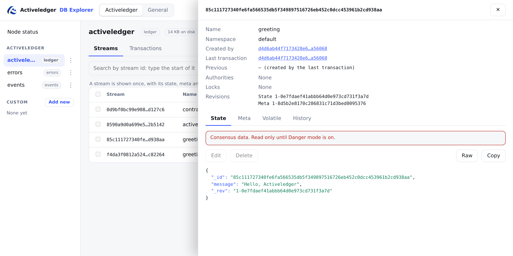
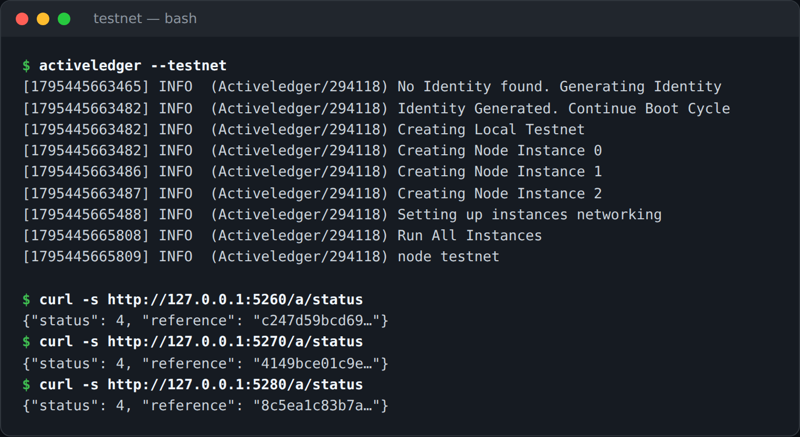
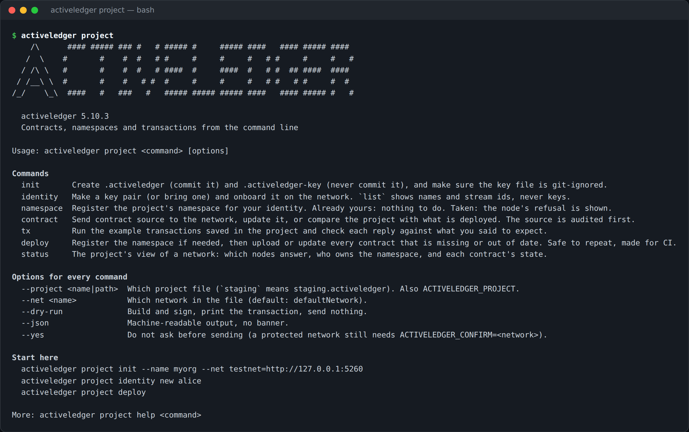
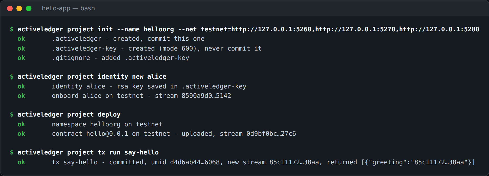
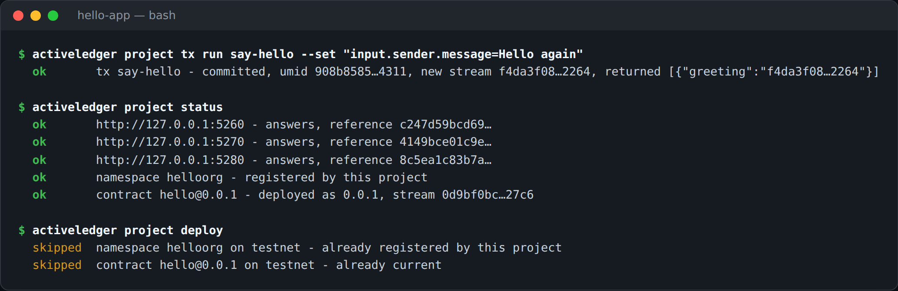
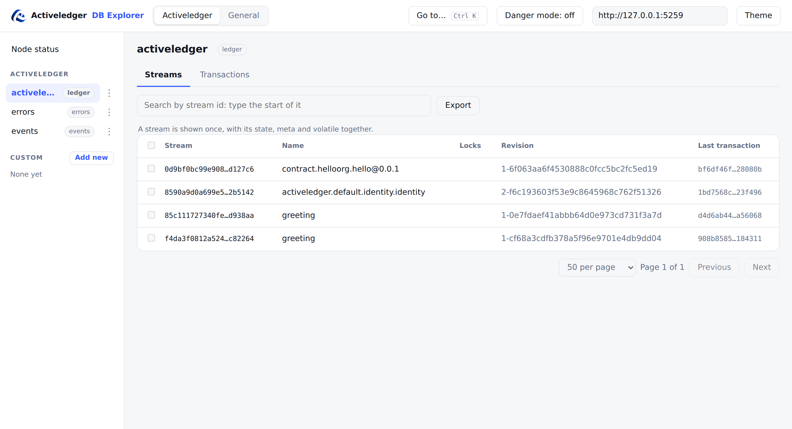
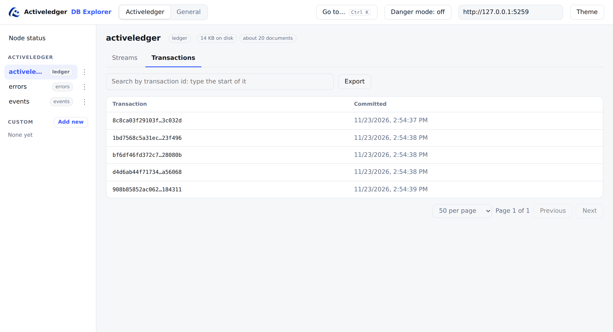
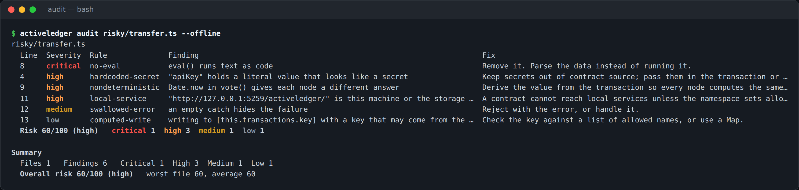

# Quickstart: a contract on a local network in five minutes

This page takes you from nothing to a contract deployed on a three-node network on your own machine, a transaction run against it, and a look at the result in the database explorer. Every command was run as written on a local network, and every picture is real output.



*A contract's output, read back from a node's own database in the built-in explorer. It is the "hello" contract below.*

You need **Node.js 24**, the version Activeledger is built and tested on. Everything below was run exactly as written on a clean local network.

## 1. Install

```bash
npm i -g --allow-scripts=classic-level,msgpackr-extract @activeledger/activeledger @activeledger/activerestore
```

> **The `--allow-scripts` flag matters on npm 11.19 and later**, which no longer runs install scripts by default. Activeledger's datastore builds a native LevelDB binding during install; without the flag the install succeeds and the failure only shows later, at runtime. On an older npm the flag is harmless.

## 2. Start a three-node network on your machine

```bash
mkdir testnet && cd testnet
activeledger --testnet      # creates instance-0, instance-1 and instance-2
node testnet                # starts all three; leave this running
```



The nodes answer on ports 5260, 5270 and 5280. Open a second terminal for the rest.

## 3. Write a contract

A contract is one TypeScript file: a class that extends `Standard`. Save this as `src/hello.ts` in a new folder:

```ts
import { Standard, Activity } from "@activeledger/activecontracts";

export default class Hello extends Standard {
  private message: string;
  private greeting: Activity;

  public verify(selfsigned: boolean): Promise<boolean> {
    return selfsigned ? Promise.reject("No self sign") : Promise.resolve(true);
  }

  public vote(): Promise<boolean> {
    // "sender" is the label the transaction gives the signing stream
    this.message = this.transactions.$i.sender.message as string;
    return this.message ? Promise.resolve(true) : Promise.reject("A message is needed");
  }

  public commit(): Promise<any> {
    this.greeting = this.newActivityStream("greeting");
    this.greeting.setState({ message: this.message });
    this.returnToRemote({ greeting: this.greeting.getId() });
    return Promise.resolve(true);
  }
}
```

The transaction gives the signing stream the label `sender`, and the contract reads it by that label (`this.transactions.$i.sender`) rather than by its position in the list of inputs. It checks that a message was sent, then writes it to a new stream and hands the stream's id back. [Writing a contract](contracts/write.md) explains each part, and builds a bigger one.

## 4. Deploy it and run it

`activeledger project` does the setup for you. Run it on its own to see every command:



In your folder (a git repository is best, so the key file can be kept out of it):

```bash
git init
activeledger project init --name helloorg --net testnet=http://127.0.0.1:5260,http://127.0.0.1:5270,http://127.0.0.1:5280
activeledger project identity new alice
```

Pick a namespace of your own in place of `helloorg`: names are unique on a network. This made `.activeledger` (the project, which you commit) and `.activeledger-key` (your keys, which the command makes sure git ignores). Now tell the project about the contract and an example transaction, by adding these to `.activeledger`:

```json
"contracts": {
  "hello": { "source": "src/hello.ts", "version": "0.0.1" }
},
"transactions": {
  "say-hello": {
    "contract": "hello",
    "entry": "create",
    "input": { "sender": { "$stream": "@alice", "message": "Hello, Activeledger" } }
  }
}
```

```bash
activeledger project deploy            # registers the namespace, audits and uploads the contract
activeledger project tx run say-hello  # signs and sends the example, and checks the reply
```



Change a value for one run with `--set`, ask the network what it holds, or deploy again (it sees nothing changed and sends nothing):

```bash
activeledger project tx run say-hello --set "input.sender.message=Hello again"
activeledger project status
activeledger project deploy
```



Everything `project` sends is an ordinary signed transaction. [Project commands](cli/project.md) has the file formats, how keys are kept safe, protected networks, CI use and a troubleshooting table.

## 5. Look at what you made

Every node serves a read-only view of its own database. Open the first node's:

```
http://127.0.0.1:5259/_explorer
```



Each stream is shown with its state, meta, volatile data and history. Click the `greeting` stream your transaction made to see the message (the picture at the top). Every transaction the node has committed is listed too, and the page can export, compact and back up the database:



The explorer has no login, so keep the store on loopback. Ledger data is read only unless you turn on Danger mode. See [The database explorer](operate/explorer.md).

## 6. Check a contract before you deploy it

```bash
activeledger audit src/                      # a table per file, then a 0-100 risk score
activeledger audit src/ --fail-on high       # exit 1 on a high or critical finding, for CI
```



*A contract written to be wrong: it runs `eval`, holds a key, reads the clock in `vote`, reaches for the storage port and hides an error.*

The audit finds `eval`, hard-coded secrets, time and randomness inside a vote (where each node would disagree), reaches for the storage port and local services, empty `catch` blocks, duplicate code and known advisories in the packages a contract imports. `deploy` runs it for you. See [Auditing a contract](contracts/audit.md).

## Where next

- [Writing a contract](contracts/write.md) builds a larger contract and explains every part of one.
- [Project commands](cli/project.md) covers the `.activeledger` files, keeping keys out of git, protected networks and CI.
- [Keys, identities and namespaces](identities.md) and [Sending a transaction](transactions.md) show what `project` sends for you, so you can send the same transactions from your own code or an [SDK](sdks/index.md).
- [Your first network](first-network.md) sets up nodes by hand, on more than one machine.
