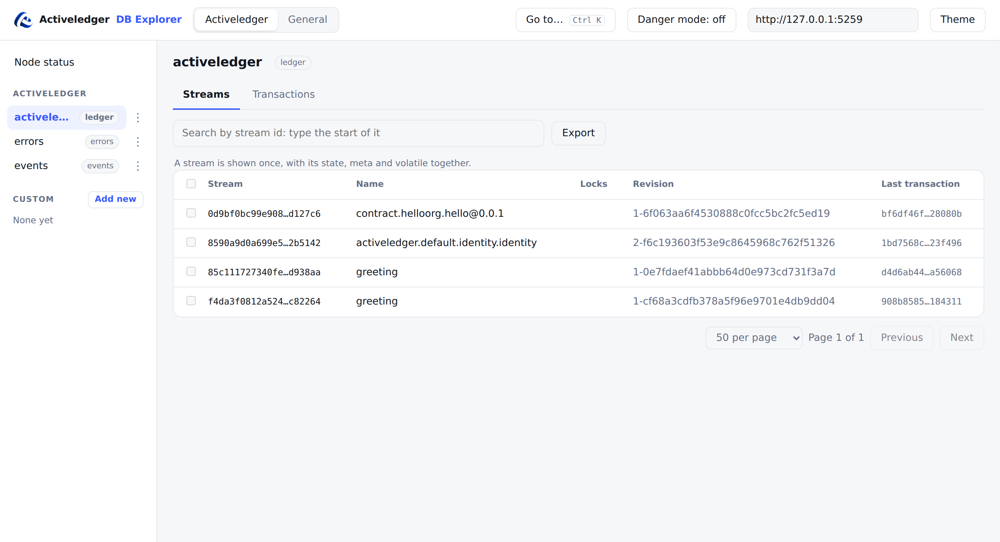
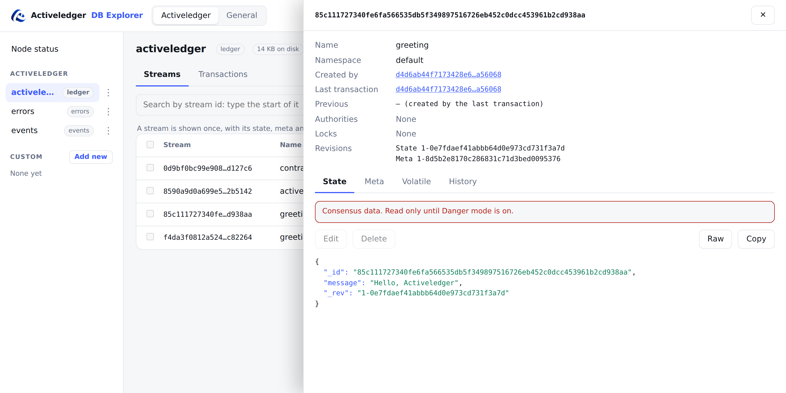

# Activestorage

Activeledger's built-in data store: an embedded LevelDB store that a node starts beside itself, with an HTTP API and a browser explorer.

This package is one part of [Activeledger](https://github.com/activeledger/activeledger). Most people want [`@activeledger/activeledger`](https://www.npmjs.com/package/@activeledger/activeledger), the node and its command line tools, which installs this package for you. Install this one directly only if you are building on it.

```bash
npm install @activeledger/activestorage
```

Needs Node.js 24 or later.

A node with `db.selfhost` in its `config.json` runs this as its own process (port 5259 by default, one below the node's API port). It stores the ledger, the events and the errors, and serves them over HTTP and a local socket. For a single process there is also an embedded form (`openEmbeddedStorage`, `EmbeddedDSConnect`), which the hybrid node uses.

## The database explorer

The store also serves a page for looking at its own data. Open it in a browser on the node's host:

```
http://127.0.0.1:5259/_explorer
```



### How it works

The explorer is one static page shipped in this package (`src/explorer`, copied to `lib/` on build) and served by the store at `/_explorer`. It reads the store's own HTTP API, so nothing is installed and nothing extra runs on the node. The port is `db.selfhost.port`; a node made with `--port` uses `port - 1`.

**There is no login.** The store has no access control, which is why it binds to loopback by default (`db.selfhost.host`). Reach it from another machine with an SSH tunnel (`ssh -L 5259:127.0.0.1:5259 node`) and do not bind it to a public address.

### What it does

- **Browse** the node's databases (the ledger, events and errors, and any custom ones), page through their documents, and open one to see its state, meta, volatile data and history. A contract's source is shown on its own tab.
- **Go to** a transaction, stream or document by pasting its id (Ctrl+K).
- **Export** the page you are on as JSON or CSV, or a whole database as JSON lines.
- **Maintain** the store: compact, back up and prune. Compact and backup are safe on a live node. Prune counts first and asks before it removes anything, and only touches the events and errors databases.
- **Edit and delete** documents, one at a time or several together, with a diff of the change to confirm before it is saved.
- Light and dark themes.



The ledger's own documents (stream state and meta) must match on every node, so they are read only until you turn on **Danger mode**. A change made that way makes this node disagree with the network, so use it only when you mean to. Restoring a backup needs it too.

The explorer is for an operator checking a node, not an API to build on: applications use the node's HTTP API, and writing to the store directly bypasses consensus.

## Documentation

- [The Activeledger guide](https://activeledger.github.io/activeledger/)
- [The database explorer](https://activeledger.github.io/activeledger/operate/explorer/) and [Pruning old data](https://activeledger.github.io/activeledger/operate/prune/)
- [Source and issues](https://github.com/activeledger/activeledger/tree/master/packages/storage)

MIT licensed.
